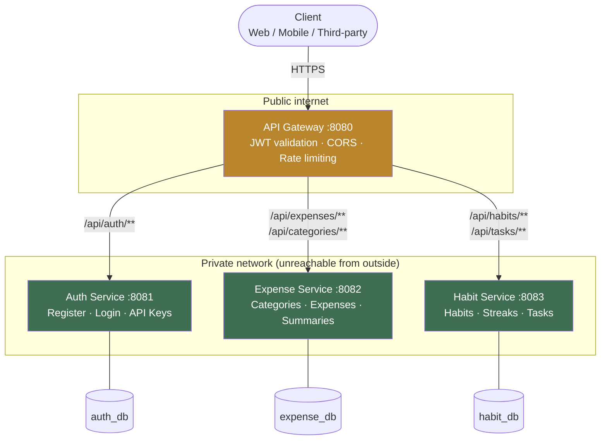
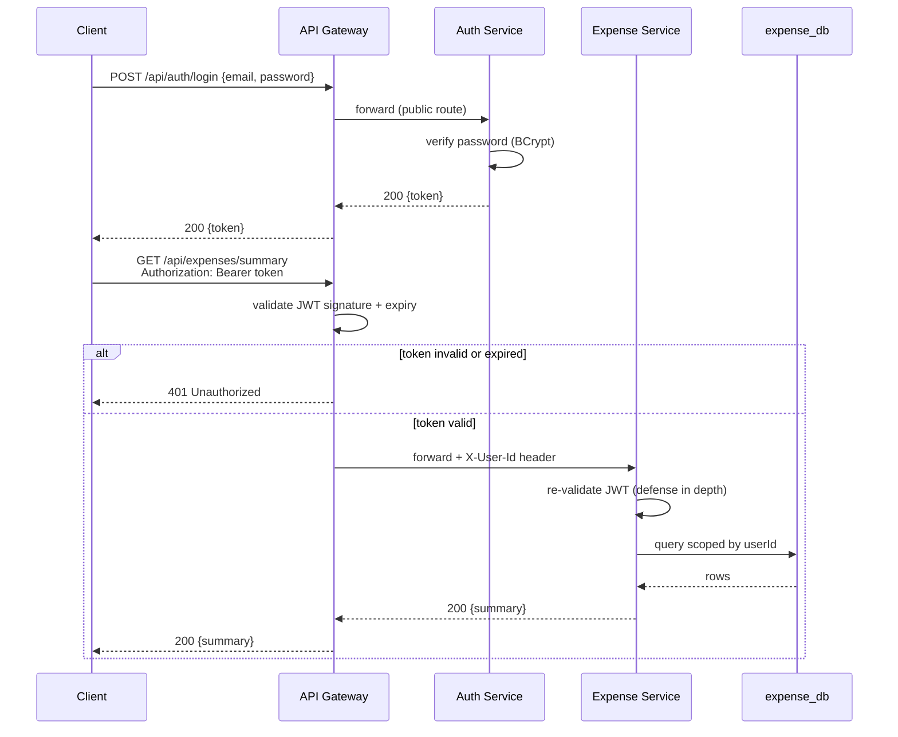

# Personal Tracker — Backend

[](https://openjdk.org/)
[](https://spring.io/projects/spring-boot)
[](https://spring.io/projects/spring-cloud-gateway)
[](https://www.postgresql.org/)
[](https://www.docker.com/)
[](#license)

A personal finance and habit/task tracker, built as a real multi-service system in Spring Boot — not a toy example. Multi-tenant: every user only ever sees their own data, enforced at the database query level in every service.

**Frontend repository:** [tally-web](https://github.com/Sidd-Tiwari/tally-web)

---

## Architecture



- **API Gateway** — the only entrypoint clients ever call. Routes to the right service by static URL (an env var per service), validates the JWT up front, applies rate limiting, handles CORS, and forwards the authenticated user's ID downstream via an `X-User-Id` header.
- **Auth Service** — registration/login, issues JWTs (24h for user sessions, 1 year for developer API keys). Owns `auth_db`.
- **Expense Service** — categories, expense/income entries, monthly summaries. Owns `expense_db`.
- **Habit Service** — habits with streak tracking, plus independent one-off tasks. Owns `habit_db`.

There's intentionally no service discovery (Eureka) in production — useful for local dev flexibility, but unnecessary complexity once deployed, since a real host (like Render) gives every service a stable address on its own. See [`DEPLOY.md`](./DEPLOY.md) for the full production topology, which additionally makes `auth-service`, `expense-service`, and `habit-service` **private** — unreachable except through the gateway.

### Request flow: authentication → protected resource



**Data ownership rule:** no service ever queries another service's database directly. Every entity stores a `userId` (a UUID trusted from the validated JWT) rather than a foreign key across service boundaries — in a real deployment, these databases could live on entirely different servers.

**Security:** the JWT is validated twice — once at the gateway (fast rejection of bad requests before they touch a service) and again inside each service (defense in depth, so no service is ever left trusting the network alone).

## Features

- Multi-user authentication with JWT sessions
- Long-lived developer API keys for third-party integrations (same JWT mechanism, longer expiry)
- Full expense/income tracking with custom categories and monthly summaries
- Habit tracking with automatic streak calculation (increments on consecutive days, resets on a missed day)
- Independent task management with due dates and priority levels
- Gateway-level rate limiting and CORS, ready for public exposure
- One-command deployment to Render via a committed Blueprint (`render.yaml`)
- Fully Dockerized — every service ships with its own multi-stage Dockerfile

## Tech Stack

| Layer | Technology |
|---|---|
| Language / Runtime | Java 17 |
| Framework | Spring Boot 3.2, Spring Cloud Gateway 2023.0 |
| Security | Spring Security, JWT (JJWT), BCrypt |
| Persistence | Spring Data JPA, PostgreSQL 16 |
| Build | Maven (multi-module reactor) |
| Containerization | Docker (multi-stage builds) |
| Deployment | Render (Blueprint-based) |

## Prerequisites

- JDK 17+
- Maven 3.8+
- Docker (for Postgres) — or install Postgres locally and skip `docker-compose`

## Getting Started

**1. Start the databases**

```bash
docker compose up -d
```

Starts one Postgres container and auto-creates `auth_db`, `expense_db`, `habit_db` (see `init-db.sql`). Default credentials: `tracker` / `tracker`.

**2. Build everything**

```bash
mvn clean install
```

**3. Start each service** (each in its own terminal, or use a process manager). Order doesn't matter except the gateway is most useful started last:

```bash
cd auth-service    && mvn spring-boot:run
cd expense-service && mvn spring-boot:run
cd habit-service   && mvn spring-boot:run
cd api-gateway     && mvn spring-boot:run
```

All requests go through the gateway at **`http://localhost:8080`**.

## API Reference

### Auth (public)

```
POST /api/auth/register   { "name", "email", "password" }  -> { token, userId, name, email }
POST /api/auth/login      { "email", "password" }           -> { token, userId, name, email }
```

Use the returned `token` as `Authorization: Bearer <token>` on every other request.

### Developer API keys (auth required)

```
POST   /api/auth/api-keys       { "label" }  -> { id, label, key, issuedAt, expiresAt }
GET    /api/auth/api-keys
DELETE /api/auth/api-keys/{id}
```

### Expenses & categories (auth required)

```
GET    /api/categories
POST   /api/categories        { "name", "type", "icon" }
DELETE /api/categories/{id}

GET    /api/expenses
POST   /api/expenses          { "amount", "description", "categoryId", "type", "expenseDate" }
PUT    /api/expenses/{id}
DELETE /api/expenses/{id}
GET    /api/expenses/summary?year=2026&month=7   -> { totalIncome, totalExpense, netBalance }
```

### Habits & tasks (auth required)

```
GET    /api/habits
POST   /api/habits            { "name", "frequency" }        # frequency: DAILY | WEEKLY
POST   /api/habits/{id}/complete                             # marks today done, updates streak
DELETE /api/habits/{id}

GET    /api/tasks
POST   /api/tasks             { "title", "description", "dueDate", "priority" }
PUT    /api/tasks/{id}
POST   /api/tasks/{id}/toggle                                 # flips completed on/off
DELETE /api/tasks/{id}
```

Full documentation with examples and error formats: [`API_REFERENCE.md`](./API_REFERENCE.md).

## Example Flow (curl)

```bash
# Register
curl -X POST http://localhost:8080/api/auth/register \
  -H "Content-Type: application/json" \
  -d '{"name":"Priya","email":"priya@example.com","password":"secret123"}'

# Copy the "token" from the response, then:
TOKEN="paste-token-here"

curl -X POST http://localhost:8080/api/categories \
  -H "Authorization: Bearer $TOKEN" -H "Content-Type: application/json" \
  -d '{"name":"Groceries","type":"EXPENSE","icon":"🛒"}'

curl -X POST http://localhost:8080/api/habits \
  -H "Authorization: Bearer $TOKEN" -H "Content-Type: application/json" \
  -d '{"name":"Read 20 minutes","frequency":"DAILY"}'
```

## Deploying This Publicly

See [`DEPLOY.md`](./DEPLOY.md) for the full Render deployment guide (one public gateway + three private services + shared Postgres, all from a single `render.yaml` Blueprint), and [`API_REFERENCE.md`](./API_REFERENCE.md) for the reference to hand to anyone building against the API — covers both end-user login and long-lived developer API keys.

## Roadmap

- [ ] Refresh tokens and email verification
- [ ] True API-key revocation (currently stateless JWTs — see tradeoffs in `DEPLOY.md`)
- [ ] Database migrations via Flyway (replacing `ddl-auto: update`)
- [ ] `notification-service` for budget alerts and streak-break reminders
- [ ] Redis-backed distributed rate limiting for horizontal scaling

## Notes on Production Readiness

- `jwt.secret` in each `application.yml` is a dev-only default — set the `JWT_SECRET` environment variable to a long, random value in real deployments, and use the same value across all services (Render prompts for this — see `DEPLOY.md`).
- `ddl-auto: update` is convenient for development; switch to migrations (Flyway/Liquibase) before this handles real user data at scale.
- Rate limiting and developer API keys are already in place; see the roadmap above for what's next.

## Project Structure

```
tally-backend/
├── pom.xml                    # Parent POM — shared dependency versions
├── render.yaml                # Render Blueprint — one-shot deploy config
├── DEPLOY.md                  # Render deployment guide
├── API_REFERENCE.md           # Public API docs for end users & third-party developers
├── render-deploy-setup.sql    # One-time SQL to add the 2nd/3rd database on Render
├── docker-compose.yml         # Postgres for local dev (all 3 databases)
├── init-db.sql
├── api-gateway/                # + Dockerfile
├── auth-service/               # + Dockerfile
├── expense-service/            # + Dockerfile
└── habit-service/              # + Dockerfile
```

## License

This project is licensed under the MIT License.

---

## Author

**Siddharth Tiwari**

- Portfolio: [siddharth-tiwari.vercel.app](https://siddharth-tiwari.vercel.app/)
- LinkedIn: [in/siddharth-tiwari-394451271](https://www.linkedin.com/in/siddharth-tiwari-394451271/)
- GitHub: [@Sidd-Tiwari](https://github.com/Sidd-Tiwari)
- LeetCode: [Sidd-Tiwari](https://leetcode.com/u/Sidd-Tiwari/)

If you found this project useful or interesting, consider giving it a ⭐ on GitHub.
